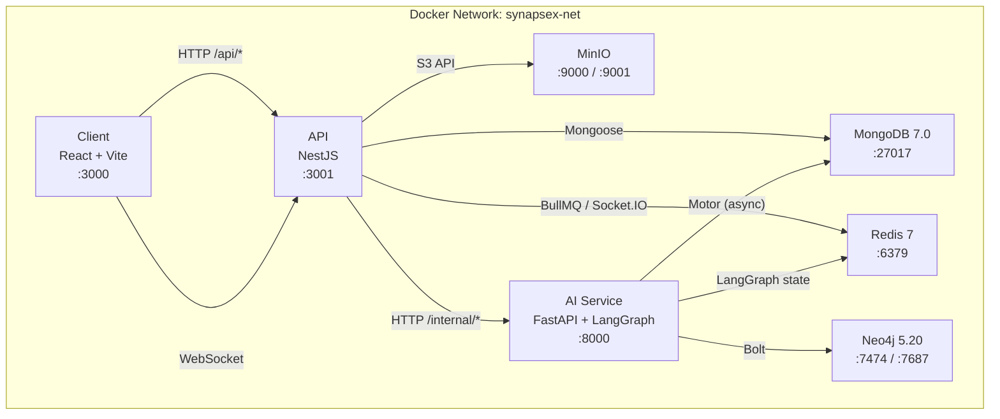

# SynapseX Infrastructure

Local multi-service development and deployment infrastructure orchestration for **SynapseX**, built using [Docker Compose](https://docs.docker.com/compose/).

## Architecture



## Service Topology & Port Mappings

| Service | Container | Image / Build | Host Port | Description |
| :--- | :--- | :--- | :--- | :--- |
| `mongodb` | `synapsex-mongodb` | `mongo:7.0` | `27017` | Primary document database |
| `redis` | `synapsex-redis` | `redis:7-alpine` | `6379` | Cache, BullMQ queues, & WebSocket adapter |
| `neo4j` | `synapsex-neo4j` | `neo4j:5.20-community` | `7474`, `7687` | Knowledge Graph (Browser & Bolt) |
| `minio` | `synapsex-minio` | `minio/minio` | `9000`, `9001` | S3-compatible evidence file storage |
| `minio-init` | `synapsex-minio-init` | `minio/mc` | — | Auto-provisions evidence & report buckets |
| `api` | `synapsex-api` | `../api` (Dockerfile) | `3001` | NestJS API & Gateway |
| `ai-service` | `synapsex-ai-service` | `../ai-service` (Dockerfile) | `8000` | FastAPI + LangGraph AI Microservice |
| `client` | `synapsex-client` | `../client` (Dockerfile) | `3000` | React + Vite frontend |

## Prerequisites

- **Docker Engine** 24.0+ ([Install](https://docs.docker.com/engine/install/))
- **Docker Compose** 2.20+ (bundled with Docker Desktop)
- **Minimum 4 GB RAM** allocated to Docker
- **Ports available**: 3000, 3001, 6379, 7474, 7687, 8000, 9000, 9001

## Quick Start

### 1. Configure Environment

```bash
cd infrastructure
cp .env.example .env
```

Open `.env` and review the defaults. For local development, the defaults work out of the box. For any deployment beyond local, **you must change all passwords and secrets**.

> **⚠️ Important**: Never commit the `.env` file. It is already in `.gitignore`.

### 2. Start the Full Application Stack

Build and launch all services:

```bash
docker compose up --build
```

On first run this will:
1. Build the `client`, `api`, and `ai-service` images
2. Pull `mongo:7.0`, `redis:7-alpine`, `neo4j:5.20-community`, `minio/minio`
3. Start infrastructure services and wait for health checks to pass
4. Run `minio-init` to provision the `synapsex-evidence` and `synapsex-reports` buckets
5. Start the API once MongoDB, Redis, and MinIO are healthy
6. Start the AI Service once MongoDB, Redis, and Neo4j are healthy
7. Start the Client once the API health check passes

To run in detached (background) mode:

```bash
docker compose up -d --build
```

### 3. Start Infrastructure Only (for Local Native Development)

If you're running the API / Client / AI service natively on your machine and only need Dockerized databases:

```bash
docker compose up -d mongodb redis neo4j minio minio-init
```

### 4. Development Mode (Debug Ports + Admin UIs)

For enhanced developer experience with Node.js inspector, verbose logging, and Mongo Express:

```bash
docker compose -f docker-compose.yml -f docker-compose.dev.yml up --build
```

This adds:
- **API debug port** at `localhost:9229` (attach VS Code / Chrome DevTools)
- **Mongo Express** web UI at [http://localhost:8081](http://localhost:8081)
- **Verbose logging** for all application services
- **Vite HMR polling** for reliable hot-reload on Windows / WSL2

### 5. Verify Services

Once the stack is running, verify each service:

| Service | URL | Credentials |
| :--- | :--- | :--- |
| Client App | [http://localhost:3000](http://localhost:3000) | — |
| API Health | [http://localhost:3001/api/v1/health](http://localhost:3001/api/v1/health) | — |
| API Swagger | [http://localhost:3001/api/docs](http://localhost:3001/api/docs) | — |
| AI Service Docs | [http://localhost:8000/docs](http://localhost:8000/docs) | — |
| Neo4j Browser | [http://localhost:7474](http://localhost:7474) | `neo4j` / `synapsex_neo4j_password` |
| MinIO Console | [http://localhost:9001](http://localhost:9001) | `minioadmin` / `minioadmin` |
| Mongo Express* | [http://localhost:8081](http://localhost:8081) | No auth (dev only) |

*\*Only available when using `docker-compose.dev.yml` overlay.*

Check container health status:

```bash
docker compose ps
```

All services should show `healthy` in the STATUS column.

### 6. Stopping the Stack

```bash
# Stop containers, preserve data volumes
docker compose down

# Stop containers AND delete all persistent data
docker compose down -v
```

## Useful Commands

```bash
# View logs for a specific service
docker compose logs -f api

# Shell into a running container
docker compose exec api sh
docker compose exec mongodb mongosh -u admin -p synapsex_admin_password

# Rebuild a single service without affecting others
docker compose up -d --build api

# Force-recreate containers (useful after config changes)
docker compose up -d --force-recreate

# Check container resource usage
docker compose stats
```

## Persistent Storage Volumes

| Volume | Purpose |
| :--- | :--- |
| `mongodb_data` | Collections, indexes, and document data |
| `redis_data` | BullMQ queue state and AOF snapshots |
| `neo4j_data` | Graph nodes, relationships, and property stores |
| `neo4j_logs` | Cypher transaction logs and query logs |
| `minio_data` | Raw forensic evidence files and generated reports |

All volumes are Docker-managed named volumes. Data persists across `docker compose down` and is only removed with `docker compose down -v`.

## Health Check Strategy

Every service has a Docker `HEALTHCHECK` instruction. The startup dependency chain ensures services only receive traffic once their dependencies are confirmed healthy:

```
mongodb ─────────┐
redis ───────────┤
                 ├─► api ─────────────► client
minio ───────────┘       
  │                      
  └─► minio-init         
                         
mongodb ─────────┐
redis ───────────┤
                 ├─► ai-service
neo4j ───────────┘
```

## Troubleshooting

### Port Conflicts

If you see `Bind for 0.0.0.0:3001 failed: port is already allocated`:

```bash
# Find what's using the port (Windows PowerShell)
netstat -ano | findstr :3001

# Or change the port in your .env
API_PORT=3002
```

### MongoDB Auth Failures

If the API cannot connect to MongoDB after changing credentials:

```bash
# The init script only runs on FIRST container creation.
# To re-run it, delete the volume and recreate:
docker compose down -v
docker compose up -d
```

### Slow Hot-Reload on Windows / WSL2

Docker volume mounts on Windows can have slow filesystem events. Use the dev overlay which enables polling:

```bash
docker compose -f docker-compose.yml -f docker-compose.dev.yml up --build
```

### Neo4j Fails to Start

Neo4j requires at least 512MB heap. Ensure Docker Desktop is allocated ≥4GB RAM:
- **Docker Desktop** → Settings → Resources → Memory → 4.00 GB+

### "exec format error" on ARM Macs

If you see this error on Apple Silicon, ensure you have Docker Desktop 4.25+ which includes Rosetta emulation. Alternatively, pull arm64 images:

```bash
docker compose pull --platform linux/arm64
```

### Container Logs

Always check logs first when debugging:

```bash
# All services
docker compose logs --tail=50

# Single service with follow
docker compose logs -f ai-service
```
